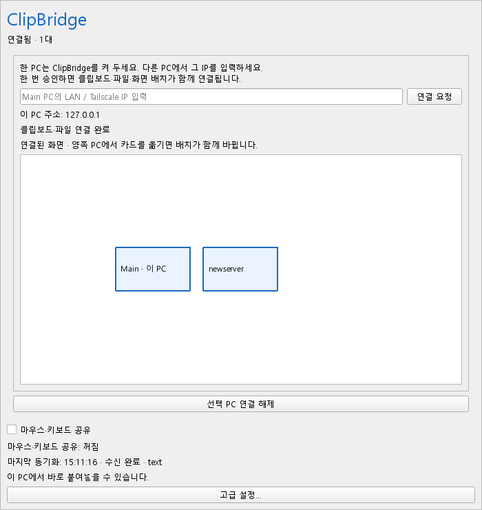

# ClipBridge

**IP 입력 → 상대 PC에서 승인 → 연결 완료.** 클립보드·파일·마우스를 한 번에 연결합니다. 인증 코드나 서버/클라이언트 설정은 필요 없습니다.

## 다운로드

[최신 버전 받기](https://github.com/yhc1001/ClipBridge/releases/latest)

| 내 컴퓨터 | 받을 파일 |
|---|---|
| Windows · 설치 없이 실행 | `ClipBridge-portable.zip` |
| Windows · UAC 화면에서도 입력 | `ClipBridge-UAC-setup-x64.msi` |
| Apple 칩 / Intel Mac | `ClipBridge-macOS-arm64.zip` / `ClipBridge-macOS-intel.zip` |
| Linux x86_64 · X11 | `ClipBridge-linux-x86_64.tar.gz` |

Deskflow나 Python을 따로 설치할 필요 없습니다. **연결할 PC 모두 v1.6.2로 업데이트하세요.** 기존 Deskflow·ClipBridge는 트레이에서 종료한 뒤 새 버전을 실행합니다. Windows 설치형은 MSI 설치 후 시작 메뉴의 ClipBridge를 여세요. 이미 UAC 설치형을 쓰고 있다면 EXE만 교체하지 말고 MSI도 업데이트하세요.

## 연결은 세 단계

1. **Main:** ClipBridge를 켜 두세요. 화면에 **이 PC 주소**가 표시됩니다.
2. **newserver 또는 다른 PC:** Main의 IP를 입력하고 **연결 요청**을 누릅니다.
3. **Main:** 같은 확인 번호가 표시된 요청에서 **연결 허용**을 누르면 끝입니다.

클립보드·파일이 바로 양방향으로 공유되고, 두 PC에 같은 화면 배치가 나타납니다. 다른 PC를 추가할 때도 같은 방법입니다. Main 1대에 다른 PC 최대 16대까지 연결합니다.

**마우스는 ‘마우스·키보드 공유’ ON/OFF만 바꾸세요.** 꺼도 복사·붙여넣기는 계속 됩니다. 화면 카드를 드래그하면 양쪽 배치가 함께 바뀌며, 화면 가장자리로 마우스를 옮겨 다른 PC로 넘어갑니다.

**화면 경계에서는 기다리지 않고 바로 전환합니다.** v1.6.2는 이전 기본 대기 250ms를 통합 연결에서 한 번 해제합니다.

평소에는 그냥 복사하고 붙여넣으세요. Windows·Linux는 **Ctrl+V**, Mac은 **⌘V**입니다. 파일·폴더도 매번 묻지 않고 실제 내용을 전송합니다. Moonlight로 newserver 화면만 보는 노트북에는 설치하지 않아도 됩니다.

창을 닫으면 트레이에서 계속 동작합니다. 새 설정은 로그인 자동 실행이 기본이며 기존에 꺼 둔 선택은 유지합니다. Main을 껐다 켜면 자동 재연결하고, 이후 새로 복사한 내용부터 공유합니다. **IP를 입력받아 승인한 PC가 연결 중심이므로, 그 PC가 꺼져 있는 동안 그룹 공유는 멈춥니다.**

용량·자동 시작·파일 수신 옵션은 **고급 설정…**에 있습니다. 기본 클립보드 256MiB / 파일 16GiB이며 최대 512MiB / 1TiB입니다.

## 연결이 안 되면

- **가끔 복사만 안 되면:** 기존 Deskflow의 자동 실행 서비스까지 정지하고 ClipBridge만 사용하세요. 두 프로그램이 클립보드를 함께 바꾸면 내용이 덮어써질 수 있습니다. Deskflow는 ClipBridge의 마우스가 동작하는지 확인한 뒤 제거해도 됩니다.
- **세 대를 쓸 때:** 노트북과 서버가 각각 같은 Main IP로 연결 요청을 보내야 합니다. Main의 화면 카드가 세 개이고 **클립보드·파일 · 연결됨 · 2대**인지 확인하세요. 마우스가 움직이거나 ‘PC 승인 완료’가 표시되는 것만으로 클립보드 연결을 판단하지 마세요.
- **끊겼다가 연결되면:** 연결 후 다시 복사하세요. v1.6.1은 같은 텍스트·같은 경로의 파일을 재복사해도 새 전송을 시작합니다. 통합 연결에 남아 있던 예전 단방향 설정도 양방향으로 맞춥니다.
- 양쪽을 같은 버전으로 업데이트하고 LAN 또는 Tailscale에 연결하세요. 일반 Windows 버전은 방화벽의 **사설 네트워크** 허용이 필요할 수 있습니다. 설치형은 전용 사설 규칙을 관리합니다.
- Mac은 손쉬운 사용·입력 모니터링 권한과 최초 실행 허용이 필요할 수 있습니다. Linux는 X11을 지원합니다. Wayland는 지원하지 않습니다.
- 설치형 사용법·검증 범위는 [UAC 안내](docs/WINDOWS_UAC.md), 자세한 내용은 [통합 연결 안내](docs/CONNECTION.md)에 있습니다.

승인한 PC만 TLS 암호화 통신으로 연결합니다. 외부 서버·클라우드·텔레메트리는 사용하지 않습니다.

화면 전환과 OS별 배포 검증 결과, 실물 PC에서 확인이 남은 항목은 아래 검증 결과에 구분합니다.

[검증 결과](docs/VALIDATION-v1.6.2.md) · [지원 형식](docs/FORMATS.md) · [Mac](docs/MACOS.md) · [Linux](docs/LINUX.md) · [개발·빌드](docs/DEVELOPMENT.md)
